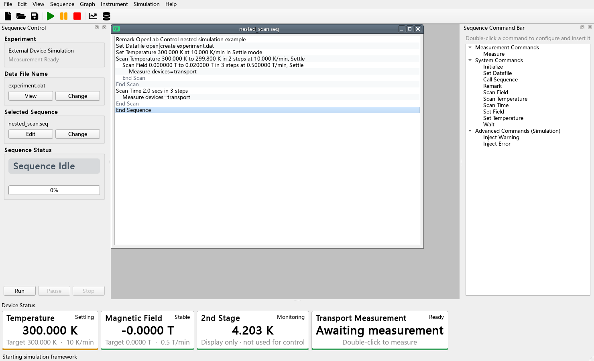

# OpenLab Control

**OpenLab Control** 是一套参考 Quantum Design MultiVu 交互方式、用 Python / PySide6 开发的低温与磁场输运实验控制框架（当前版本 `0.20.5`）。它不控制 PPMS，而是用来统一管理你自己搭建的低温、磁场与电输运测量系统。

> **在线使用与开发手册**：<https://yang-fu-physics.github.io/openlab-control/>



## 10 秒看懂架构：两类扩展

OpenLab Control 把实验室里的硬件按“职责”分成两类，目录和生命周期完全分开：

| 类型 | 负责什么 | 典型设备 | 使用习惯 | 目录 |
| --- | --- | --- | --- | --- |
| **System Instrument（系统仪表）** | 维持实验环境、持续监控状态 | 主温控仪、磁体电源、压缩机开关、冷头温度计 | 随实验台固定配置，启动时自动连接 | `system_instruments/` |
| **Measurement Module（测量模块）** | 执行一次具体的电学/物性测量 | Keithley 6221+2182A Delta、2400、2614B、6517B、LS 372A、LR-700、OE1022D 锁相 | 每次启动默认关闭（Disabled），按实验需要勾选启用 | `modules/` |

配套驱动仓库（按需手动复制到对应目录即可离线使用）：

- 系统仪表仓库：[openlab-control-Device](https://github.com/yang-fu-physics/openlab-control-Device)（Lake Shore 340、Cryo-con 22C/24C、ZLAN 压缩机继电器）
- 测量模块仓库：[openlab-control-Module](https://github.com/yang-fu-physics/openlab-control-Module)（Keithley 6221/2182A Delta、6221 AC、2400、2614B、6517B、Lake Shore 372A、LR-700、OE1022D）

## 核心功能一览

- **MultiVu 风格序列编辑（SEQ）**：可视化拖拽/双击插入指令，支持任意层级的温度扫描、磁场扫描、时间扫描与模块自定义扫描嵌套，支持 `Pause`、`Stop`、`Call Sequence`、`Set Datafile`、`Remark` 和无参数 `Measure`。
- **多模块协同与隔离运行**：每个系统仪表和每个启用的测量模块都在独立子进程中运行；同一 `Measure` 下不同模块可并行测量，多通道模块自动按槽位对齐写出每通道一行的数据。
- **实时看数与对比画图**：主窗口左侧卡片实时展示最近通道结果；**Data Browser** 可同时打开多个独立窗口对比不同 `.dat` 文件，新数据写入时自动刷新；**Live Trend** 复用已有轮询缓存，不增加额外仪表通讯。
- **完整可追溯的运行记录**：每次 Run 自动在 `runs/` 下生成独立目录，保存实验 `.dat`、原始采样 `rawdata/`、连续仪表状态 `instrument_status.dat`、事件日志 `events.dat` 以及当次 SEQ、配置与模块参数快照。
- **清晰的安全边界**：
  - 全新安装默认不启用任何面板或仿真，所有测量模块默认 `Disabled`；加载历史 SEQ 只把参数填回界面，不会自动下发到仪表（须手动点击 **Apply Settings** 确认）。
  - 温度/磁场的上下限与最大速率在配置、界面弹窗和运行时统一生效。
  - **Warning** 记录并继续实验，**Error** 立即中止 SEQ；SEQ 结束、Stop 或报错默认不会擅自改写温控/磁体设定值，测量模块则在 `run_end` 中按约定收尾输出。
  - 可选异步 HTTP 报警通知（Warning 通知测试员，Error 同时通知管理员和测试员）。
- **高分屏友好**：在 **View → Appearance** 中可分别调整整体缩放与文字大小，并自由选择窗口启动策略。

## 快速开始

### 方式一：Windows 离线发布包（推荐实验员使用）

从 GitHub Releases 下载对应版本的 `OpenLabControl-v0.20.5-windows-x64.zip`，完整解压到可写目录（无需安装 Python）：

1. 如需配置真实仪表或打开内置仿真，先双击根目录的 **`InstrumentScanner.exe`** 完成扫描与保存。
2. 双击 **`OpenLabControl.exe`** 启动主程序。
3. 在工具栏点击 **Modules** 勾选需要的测量模块（例如自带的 `Simulated Transport`），即可打开 `examples/nested_scan.seq` 体验完整运行流程。

> 两个 EXE 共享根目录的 `_internal/`，请保持整个文件夹完整，不要单独移动单个 EXE。连接 GPIB/USB 等真实仪表时，本机仍需安装对应厂商的 VISA Runtime（如 NI-VISA）。

### 方式二：源码运行（适合开发者）

需要 Python 3.11+：

```powershell
.\setup.bat
.\run.bat
```

常用开发命令：

```powershell
# 启动仪表扫描与配置向导
.\.venv\Scripts\python.exe .\tools\instrument_scanner.py

# 运行完整单元测试
.\.venv\Scripts\python.exe -m unittest discover -s tests -v

# 本地构建 Windows 文件夹发布包（输出到 dist\OpenLabControl\）
.\build.bat
```

正式稳定版由 GitHub Actions 在打上与版本号一致的 `v<版本>` 标签后自动完成全量测试、严格文档检查、双 EXE 打包并上传 ZIP 与 SHA-256 校验文件。

## 配置仪表只需四步

1. 将所需的系统仪表目录复制到 `system_instruments/<仪表名>/`（如仅使用内置仿真可跳过此步）。
2. 关闭主程序，运行 `InstrumentScanner.exe`（源码版运行 `tools\instrument_scanner.py`）。
3. 按向导完成三页配置：
   - **VISA Resources**：扫描 GPIB/USB 地址，未分配给系统仪表的地址自动留给测量模块（写入 `configs/visa.resources.toml`）。
   - **各系统仪表页**：添加物理实例，选择地址（或网络仪表的 Host/Port）、确认面板角色（`sample_temp` / `field` 全局各最多一个，其余为 `none`）及现场安全上下限。
   - **Review & Save**：按需勾选内置仿真、调整底部面板全局顺序，检查写入预览后保存。
4. 重启 OpenLab Control，在底部面板和 Run Log 中确认连接状态与读数。

> 首次配置带 PID 文件的温控仪时，扫描器会把示例模板复制到 `configs/pid/<实例ID>.toml`；此后重新保存不会覆盖或删除已有的 PID 文件。若模板中 `zones` 为空，须先填入现场验证过的参数再启动。

## 写一个最小测量模块

不需要继承框架基类，在 `modules/<模块ID>/` 下放 `module.toml` 和 `backend.py` 即可：

```python
class Module:
    columns = {"Resistance": "Ohm", "StatusCode": ""}

    def open(self, api): ...          # 点击 Enable 时初始化
    def measure(self, slot, api): ... # 每次 Measure 按槽位调用，返回一行字典
    def close(self, api): ...         # 点击 Disable 或退出时释放资源
```

如果模块会在测量期间打开电流/电压输出，请同时实现 `on_event("run_end", data, api)`：默认在 SEQ 结束、Stop 或报错时关闭输出；仅当实验确实需要跨 SEQ 保持连续偏置时，再提供默认关闭的“保持输出”选项并在保持前回读确认。

完整入门见 [写第一个测量模块](docs/development/first-module.md)；编写温控仪/磁体控制器见 [System Instrument 教程](docs/development/system-instrument.md)。

## 共享依赖说明

`PySide6`、`QtAwesome`、`packaging`、`PyVISA` 和 `typing_extensions` 由框架共享并统一锁定版本（见 `pyproject.toml` 与 `requirements-lock.txt`）。所有系统仪表和测量模块直接使用这份环境，不需要各自安装依赖。如需引入新的第三方包，统一更新核心依赖并重新构建发布包即可，确保实验室离线电脑开箱即用。

## 目录结构

```text
configs/
├─ general.toml              唯一通用配置（界面、日志、报警、超时）
├─ visa.resources.toml       测量模块可用的 VISA 清单（扫描器生成）
├─ instruments/              系统仪表实例与限值配置（扫描器生成）
└─ pid/                      各温控实例独立的现场 PID 参数
modules/                     测量模块目录（自带教学与仿真示例）
system_instruments/          系统仪表目录（自带教学骨架）
module_data/<id>/            各模块保存的界面设置
examples/                    示例 SEQ / DAT / PLT 文件
runs/                        每次实验的完整数据、日志与配置快照
docs/                        中文使用与开发教程（MkDocs 站点源码）
src/labcontrol/              核心框架源码
tests/                       核心自动化测试
tools/                       扫描器与打包辅助脚本（发布包中不保留此目录）
```

## 文档导航

- [在线中文文档](https://yang-fu-physics.github.io/openlab-control/)
- [操作手册](docs/OPERATIONS.md) · [仪表扫描与配置](docs/guides/instrument-scanner.md) · [Data Browser](docs/guides/data-browser.md)
- [Measurement Module 开发教程](docs/development/index.md) · [System Instrument 开发教程](docs/development/system-instrument.md)
- [配置参考](docs/CONFIGURATION.md) · [SEQ 格式](docs/SEQUENCE_FORMAT.md) · [DAT 与事件格式](docs/DAT_FORMAT.md)
- [系统架构](docs/ARCHITECTURE.md) · [完整开发规范](docs/DEVELOPMENT_REFERENCE.md)

## 实机验证状态与安全提示

- **已实机验证（2026-11-05，现场确认）**：Lake Shore 340 温控、ZLAN 压缩机控制以及 Keithley 6221 + 2182A Delta 测量已完成现场实机测试（仅覆盖已测试的接线与配置）。
- **其他型号与模式**：目前仅完成仿真和协议测试，接入真机前请务必对照 [真实仪表安全清单](docs/guides/safety-checklist.md) 从只读检查与低风险负载开始逐步验证，完成验证前请勿无人值守运行。
- **硬件保护优先**：软件限值与进程隔离永远不能替代仪表本机的限流/限压/限温保护、硬件联锁和人工急停。
