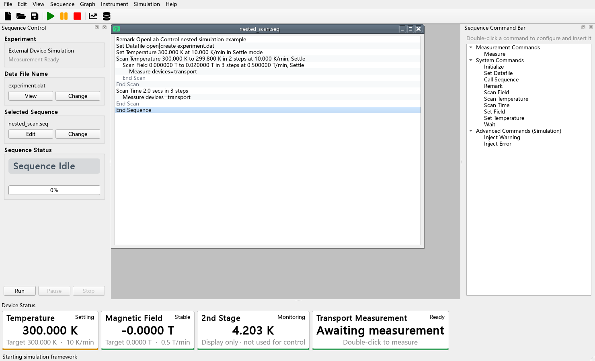

---
hide:
  - navigation
  - toc
---

<section class="olc-hero">
  <div>
    <div class="olc-eyebrow">OpenLab Control 0.20.6 · 中文使用与开发手册</div>
    <h1>像 MultiVu 一样编排你的低温与输运实验。</h1>
    <p class="olc-hero-copy">
      OpenLab Control 是一套开源的实验室自动化控制框架：用树状 SEQ 编排变温、扫场和定时步骤，
      按需勾选测量模块采集多通道数据，并在独立窗口中实时看图。无需读懂整个主程序，就能快速上手使用或扩展自己的仪表。
    </p>
    <div class="olc-actions">
      <a class="md-button md-button--primary" href="getting-started/">快速上手</a>
      <a class="md-button" href="OPERATIONS/">操作手册</a>
      <a class="md-button" href="development/">开发测量模块</a>
    </div>
  </div>
  <div class="olc-terminal" aria-label="最小 SEQ 与模块示意">
    <pre><code><span class="olc-keyword"># 1. 用树状 SEQ 编排变温、扫场与测量</span>
T Set Temperature 10 K at 5 K/min in Settle mode
T Scan Field -1 T to 1 T in 21 steps at 0.5 T/min, Settle
T     Measure
T End Scan
T End Sequence

<span class="olc-keyword"># 2. 最小测量模块只需三个方法</span>
<span class="olc-keyword">class</span> Module:
    columns = {<span class="olc-string">"Resistance"</span>: <span class="olc-string">"Ohm"</span>}
    <span class="olc-keyword">def</span> <span class="olc-method">open</span>(self, api): ...
    <span class="olc-keyword">def</span> <span class="olc-method">measure</span>(self, slot, api):
        <span class="olc-keyword">return</span> {<span class="olc-string">"Resistance"</span>: 100.0}
    <span class="olc-keyword">def</span> <span class="olc-method">close</span>(self, api): ...</code></pre>
  </div>
</section>

<div class="olc-statbar">
  <div class="olc-stat"><strong>开箱仿真</strong><span>无需硬件，5 分钟跑通完整实验</span></div>
  <div class="olc-stat"><strong>按需加载</strong><span>测量模块独立开关，互不干扰</span></div>
  <div class="olc-stat"><strong>完整留痕</strong><span>数据、配置、日志自动归档</span></div>
  <div class="olc-stat"><strong>安全优先</strong><span>三层限值保护，不悄悄改写仪表</span></div>
</div>

## 根据你的角色选择入口

<p class="olc-section-lead">
不需要从头到尾读完所有文档。先看你想做什么，再直接进入对应章节。
</p>

<div class="olc-card-grid">
  <a class="olc-card" href="getting-started/">
    <span class="olc-card-number">01 · 实验员</span>
    <h3>安装、配表与运行实验</h3>
    <p>解压即用 Windows 发布包，用扫描向导认出仪表，编写第一条 SEQ 并在 Data Browser 中实时看图。</p>
  </a>
  <a class="olc-card" href="development/">
    <span class="olc-card-number">02 · 测量模块开发者</span>
    <h3>接入电阻、电压或锁相测量</h3>
    <p>把一台或多台测量仪表封装成独立模块，支持多通道对齐、设置窗口、原始数据和自定义 SEQ 指令。</p>
  </a>
  <a class="olc-card" href="development/system-instrument/">
    <span class="olc-card-number">03 · 系统维护者</span>
    <h3>接入温控仪、磁体或监视表</h3>
    <p>只有更换或新增主温度、主磁场、压缩机开关或常驻监控仪表时才需要阅读这一部分。</p>
  </a>
</div>

## 一张表分清两个核心概念

OpenLab Control 把所有硬件分成两类，职责清晰、互不越界：

| 对比项 | System Instrument（系统仪表） | Measurement Module（测量模块） |
| --- | --- | --- |
| **管什么** | 实验环境：主温度、主磁场、压缩机、冷头温度等 | 数据采集：电阻、I-V、Delta、锁相、电桥等 |
| **什么时候启用** | 随实验台固定配置，主程序启动后常驻连接 | 每次启动默认关闭，做实验前按需勾选 Enable |
| **怎么配置** | 使用 **Instrument Scanner** 向导统一扫描并设置安全限值 | 在主程序 **Modules** 窗口中打开专属 Settings 页并手动 Apply |
| **谁负责数据文件** | 持续记录到 `instrument_status.dat`，并在测量时刻提供同步温场 | 返回各通道测量值，由主程序统一写入实验 `.dat` |

## 典型实验工作流

```text
① Instrument Scanner 确认仪表地址与限值（首次或更换硬件时）
        ↓
② 打开主程序 → 在 Modules 勾选所需测量模块 → 核对参数并点击 Apply Settings
        ↓
③ 编辑或加载 .seq → 确认数据文件路径 → 点击 Run
        ↓
④ 左侧卡片看实时数值 / Data Browser 对比曲线 / runs/ 自动保存完整记录
```

<div class="olc-screenshot">
  
  <p>OpenLab Control 主窗口：左侧为运行控制与模块监视卡，中间为 SEQ 与画图区，右侧为指令栏，底部为系统仪表面板。</p>
</div>

!!! warning "接入真实硬件前请先做低风险验证"

    2026-11-05 已现场完成 Lake Shore 340 温控、ZLAN 压缩机控制和 Keithley 6221 + 2182A Delta 测量的实机测试（仅覆盖已测接线与配置）。
    接入其他型号或新接线前，请先阅读[仪表安全清单](guides/safety-checklist.md)，务必保留仪表本机限流/限压/限温保护、硬件联锁与人工急停。

<div class="olc-next">
  <a href="getting-started/">开始使用：5 分钟跑通仿真实验 →</a>
  <a href="development/first-module/">模块开发：动手写第一个测量模块 →</a>
</div>
